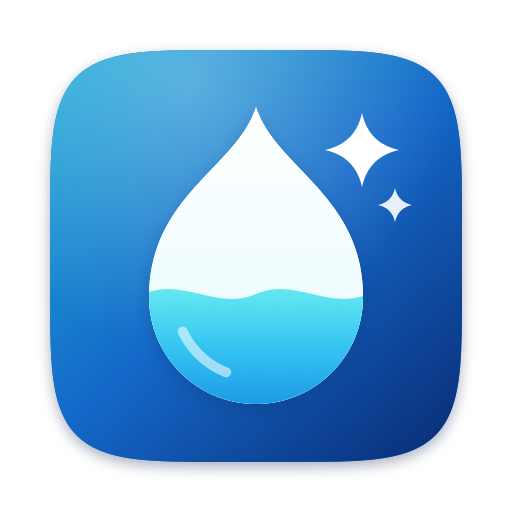

<h1 align="center">Cleanwell</h1>

安全、透明的 Mac 清理工具 · A safe, transparent Mac cleaner

<b><a href="https://github.com/yuting-ai/Cleanwell/releases/latest/download/Cleanwell.dmg">⬇ 下载 Cleanwell.dmg · Download</a></b> · <a href="https://lepton.me/cleanwell">lepton.me/cleanwell</a>

macOS 14 或更高 · Apple 芯片和 Intel · 已通过 Apple 公证 · 免费 macOS 14 or later · Apple silicon &amp; Intel · Notarized by Apple · Free

---

## 功能

- **一键清理**：系统缓存和日志、浏览器缓存、Xcode / npm / Homebrew 等开发者垃圾、下载文件夹里的旧安装包
- **先进废纸篓**：默认移到废纸篓，随时可以放回原处；每次清理都逐项写进操作日志
- **大文件和重复文件**：删除前再核对一次，扫描后变过的文件不会被动
- **卸载 App**：连同偏好设置、缓存、沙盒容器和启动项一起移除，和其他 App 共用的文件单独标出
- **已卸载 App 的残留**：按厂商分组，默认不勾选，由你逐个确认
- **磁盘占用**：方块图逐层查看每个文件夹占了多少空间
- **定时清理**：每天或每周在后台清理安全的项目
- **系统级清理（可选）**：安装特权助手后清理 `/Library` 里第三方软件的缓存和日志、系统已经压缩归档的旧日志和崩溃报告；只认严格的白名单，不碰 Apple 的缓存和系统正在写的日志
- 中文 / English 界面，自动更新

## 安装

1. 下载 [Cleanwell.dmg](https://github.com/yuting-ai/Cleanwell/releases/latest/download/Cleanwell.dmg)，打开后把 Cleanwell 拖进「应用程序」
2. 打开 Cleanwell，点「开始扫描」
3. 想扫描得更完整：在「系统设置 → 隐私与安全性 → 完全磁盘访问权限」中允许 Cleanwell

## 隐私

扫描和清理都只在你的 Mac 上进行。唯一的联网操作是检查更新，会附带一个随机生成的 ID 和版本号，用来统计有多少人在用，不包含任何个人信息或文件信息，可以在「设置 → 通用」里关掉。

---

## Features

- **One-click cleanup** — system caches and logs, browser caches, developer junk from Xcode, npm, Homebrew and more, and old installers in Downloads
- **Trash first** — everything goes to the Trash by default so you can put it back; every item cleaned is written to an operation log
- **Large & duplicate files** — each file is checked again before removal; anything changed since the scan is left alone
- **Uninstaller** — removes an app with its preferences, caches, containers and launch agents; files shared with other apps are marked
- **Leftovers of removed apps** — grouped by vendor and unchecked until you confirm
- **Disk map** — a treemap to drill into what takes up space
- **Scheduled cleaning** — clean safe items daily or weekly in the background
- **System-level cleaning (optional)** — a privileged helper cleans third-party caches and logs in `/Library`, plus old compressed system logs and crash reports, following a strict allow-list and leaving Apple's caches and active system logs alone
- English / 中文 interface, automatic updates

## Install

1. Download [Cleanwell.dmg](https://github.com/yuting-ai/Cleanwell/releases/latest/download/Cleanwell.dmg), open it and drag Cleanwell into Applications
2. Open Cleanwell and click Start Scan
3. For a complete scan, allow Cleanwell in System Settings → Privacy & Security → Full Disk Access

## Privacy

Scanning and cleaning happen only on your Mac. The only network request is the update check, which includes a random ID and the app version so we can count how many people use Cleanwell — no personal or file information. You can turn it off in Settings → General.

---

Cleanwell 是免费软件，源码不公开，这个仓库只用来发布安装包。问题和建议欢迎在 [Issues](https://github.com/yuting-ai/Cleanwell/issues) 里提，或写信到 [hi@lepton.me](mailto:hi@lepton.me)。

Cleanwell is free software. Its source code is not published; this repository hosts the releases. Bug reports and ideas are welcome in [Issues](https://github.com/yuting-ai/Cleanwell/issues) or at [hi@lepton.me](mailto:hi@lepton.me).

© 2026 Lepton
